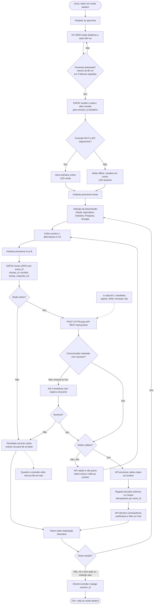

# NEXO — Totem Educativo Inteligente (proposta de IoT e Redes)

> **NEXO — Aprenda. Decida. Descubra.**

**Disciplina:** Disruptive Architectures: IoT, IoB & Generative AI — 1º Sprint
**Natureza da entrega:** proposta **conceitual**. Nenhum totem foi construído, nenhum sensor foi testado e a integração ESP32 ↔ API **não existe** nesta etapa.

**Equipe**
- Gabriel Rocha de Souza — RM 567023
- Gabriel Stuani — RM 566682
- Luis Fillipe Rodrigues — RM 567918
- Luiz Felipe Kichimoto — RM 567726
- Guilherme Soares — RM 568227

## 1. Apresentação do NEXO
O NEXO é um projeto educacional de estudantes de tecnologia que ensina a sociedade sobre as **aplicações civis da tecnologia nuclear** por meio de um jogo educativo. Funcionalidades centrais: **Mapa de Missões** (Saúde, Agricultura, Indústria, Pesquisa, Energia), **Laboratório de Decisões** (cenário com alternativas A e B), **Mito ou Fato** e **Perfil de Progresso**.

## 2. Problema
A tecnologia nuclear é associada quase só a acidentes e armas. Poucas pessoas conhecem usos como diagnóstico e tratamento médico, conservação de alimentos, ensaios industriais, pesquisa e geração de energia.

## 3. Objetivo
Levar o público a entender onde a tecnologia nuclear contribui, quando faz sentido usá-la, benefícios, limitações, cuidados e como separar ciência de desinformação. O jogo **não** trata a opção nuclear como sempre superior: em alguns cenários a alternativa correta é outra.

## 4. Público-alvo
Principal: estudantes e jovens interessados em ciência e tecnologia. Apoio: professores, instituições de ensino e divulgadores científicos.

## 5. Aplicação de IoT: o Totem NEXO
Um totem físico para escolas, laboratórios, feiras de ciências e exposições. Ele é a extensão física do jogo: detecta o visitante, abre uma missão, recebe a decisão por **botões físicos A/B**, mostra a consequência e a explicação "Mito ou Fato", registra a interação **de forma anônima** e envia sinais de saúde do equipamento a um sistema central.

**Por que não é "só um tablet na mesa"?**
| Capacidade | Tablet | Totem NEXO |
|---|---|---|
| Convida o visitante a se aproximar (modo atrativo → modo missão) | Não | Sim, por sensor de presença |
| Reinicia sozinho quando o visitante sai | Não | Sim (sessão por presença + timeout) |
| Interação robusta em evento, com muita gente | Toque aberto | Botões físicos A/B grandes |
| Monitoramento remoto (online, Wi-Fi, versão) | Não | Heartbeat para a API |
| Dados de uso por equipamento e por local | Não | Eventos anônimos por `totem_id` |

## 6. Funcionamento (resumo)
1. Visitante se aproxima (< ~80 cm). 2. HC-SR04 mede distância; ESP32 confirma presença. 3. Tela sai do modo atrativo. 4. Visitante aperta **Iniciar**. 5. Escolhe a área (Saúde, Agricultura…). 6. Totem exibe o cenário e as alternativas A/B. 7. Visitante aperta A ou B. 8. ESP32 envia a decisão por HTTPS à API. 9. API valida, registra e devolve consequência + justificativa + Mito ou Fato. 10. Totem exibe o resultado e encerra a sessão por saída ou inatividade.
Detalhes em [`docs/proposta-iot.md`](docs/proposta-iot.md) e [`docs/fluxo-dados.md`](docs/fluxo-dados.md).

## 7. Componentes e sensores
ESP32 DevKit, HC-SR04 (ou HC-SR04P), display TFT SPI 2,8", 3 botões físicos, LED de status, fonte 5 V. Descartados com justificativa: PIR, câmera, buzzer, DHT22, RFID. Tabela completa em [`docs/componentes.md`](docs/componentes.md).

## 8. Arquitetura
Seis camadas: física → comunicação (Wi-Fi) → aplicação (API REST) → processamento (Spring Boot) → persistência (Oracle) → apresentação (display do totem / app NEXO). Ver [`docs/arquitetura.md`](docs/arquitetura.md) e [`diagramas/arquitetura.mmd`](diagramas/arquitetura.mmd).

## 9. Comunicação e protocolos
**Wi-Fi (2,4 GHz) + HTTPS + REST/JSON**, reaproveitando a API Spring Boot prevista. MQTT foi avaliado e **não adotado** nesta fase (justificativa em [`docs/comunicacao.md`](docs/comunicacao.md)).

## 10. Processamento dos dados
Distâncias brutas ficam **só no ESP32** e são descartadas. Só trafegam: `totem_id`, `session_id` aleatório, `missao_id`, escolha A/B, tempo de resposta e telemetria técnica. Ver [`docs/fluxo-dados.md`](docs/fluxo-dados.md).

## 11. Benefícios
Ativação automática; interação física acessível; reinício automático; registro anônimo de interações; monitoramento remoto; dados agregados para professores e para a equipe melhorar conteúdo. Cada benefício está ligado ao componente que o produz em [`docs/proposta-iot.md`](docs/proposta-iot.md#benefícios).

## 12. Segurança e privacidade
TLS, token por dispositivo, validação no servidor, idempotência, sem câmera/microfone/biometria, sem dados pessoais, sessão aleatória e agregação mínima em relatórios. Ver [`docs/privacidade-e-seguranca.md`](docs/privacidade-e-seguranca.md).

## 13. IoB e Generative AI
- **IoB (proposta inicial, em nível agregado/anônimo):** missões mais acessadas, áreas de maior interesse, abandono por etapa, tempo por missão, escolhas A/B mais frequentes.
- **Generative AI (possibilidade futura, fora do escopo inicial):** explicações complementares e adaptação de linguagem restritas a base curada.
Ver [`docs/iob-e-genai.md`](docs/iob-e-genai.md).

## 14. Fluxograma
Arquivo editável: [`diagramas/fluxograma.mmd`](diagramas/fluxograma.mmd). Versão incorporada:



## 15. Tecnologias previstas
| Tecnologia | Situação |
|---|---|
| Flutter (app mobile) | Previsto no projeto NEXO |
| Java + Spring Boot (API REST) | Previsto no projeto NEXO |
| Oracle | Previsto no projeto NEXO |
| .NET (prova de conceito de jogadores, JSON) | Frente existente, independente do totem |
| Docker + VM Azure | Previsto para a API |
| ESP32, HC-SR04, display TFT, botões, LED | **Proposta conceitual desta entrega** |
| HTTPS/REST entre totem e API | **Proposta conceitual** (endpoints do totem ainda não existem) |
| MQTT | Avaliado, não adotado; evolução futura possível |
| IA generativa | Possibilidade futura |

## 16. Limitações
- Nada foi construído nem testado; alcance, consumo e estabilidade são estimativas a validar.
- Os endpoints `/totens/...` e as tabelas do totem são propostas; ainda não existem na API.
- Redes de eventos com portal cativo ou isolamento de clientes podem impedir a conexão.
- HC-SR04 sofre com superfícies que absorvem som e com ruído; HC-SR04 detecta objeto, não "pessoa".
- Display pequeno limita o tamanho dos textos; cenários precisam de versão curta.
- Modo offline mostra só poucas missões em cache e não atualiza conteúdo.

## 17. Conclusão
O totem dá ao NEXO uma presença física e mede, de forma anônima, o que funciona na experiência educativa. A IoT tem função clara: presença → sessão → decisão física → registro → telemetria. A proposta reaproveita a arquitetura prevista (Spring Boot, Oracle) e respeita a privacidade. O próximo passo seria um protótipo de bancada para validar presença, display e envio de um evento de teste.

## Estrutura do repositório
```
nexo-iot/
├── README.md
├── docs/ (proposta-iot, componentes, arquitetura, comunicacao, fluxo-dados, privacidade-e-seguranca, iob-e-genai, referencias)
├── diagramas/ (fluxograma.mmd, arquitetura.mmd)
├── slide-nexo (arquivo de apresentação.pdf)
└── entrega/ (checklist-e-auditoria.md, links.txt)
```
